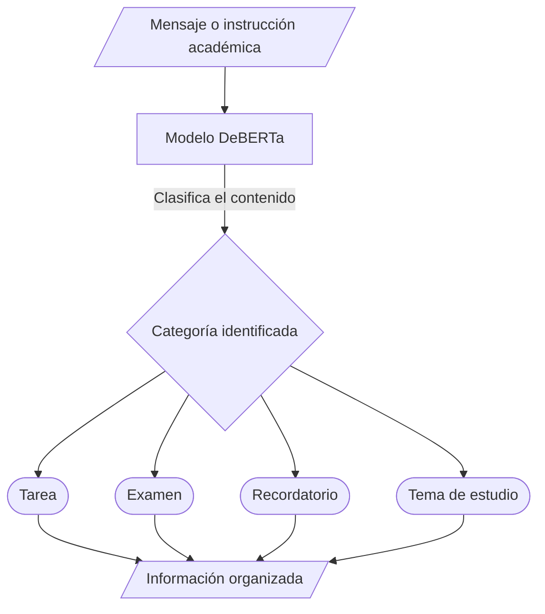

# ClassMate AI: Organizador académico inteligente

ClassMate AI es una herramienta basada en inteligencia artificial diseñada para ayudar a estudiantes universitarios a organizar su información académica. El sistema recibe textos como instrucciones de profesores, avisos de clase y pendientes escolares, y utiliza un modelo de clasificación de lenguaje para identificar y separar la información en categorías como tareas, exámenes, recordatorios y temas de estudio. Su objetivo es facilitar la organización de actividades académicas, reducir el tiempo dedicado a ordenar información y ayudar a los estudiantes a consultar sus responsabilidades de manera más clara.

## 2. Equipo

| Nombre completo | Papel en el proyecto |
|:---|:---|
| Mariano Hernández Antuñano | Caso de uso, riesgos éticos, edición del README y estructura del repositorio. |
| Javier Emilio Aranda Espinoza | Investigación y revisión de documentación. |
| Alexa González Del Castillo Torres | Investigación, organización y documentación del proyecto. |
| Paola Bocanegra Téllez | README, correcciones y organización del proyecto. |

## 3. Problemática

Los estudiantes universitarios reciben constantemente información académica mediante diferentes canales, como plataformas educativas, mensajes de profesores, documentos y apuntes. Esta información puede acumularse y dificultar la identificación de tareas, fechas de entrega, exámenes y otras responsabilidades. La falta de organización puede provocar que los estudiantes inviertan tiempo adicional buscando y clasificando información. ClassMate AI busca atender este problema mediante una herramienta que permita clasificar automáticamente los textos académicos y facilitar su consulta. La investigación completa se encuentra en [docs/investigacion.md](docs/investigacion.md).

## 4. Caso de uso

El usuario principal es un estudiante universitario que recibe instrucciones, avisos y actividades de distintas materias.

El estudiante introduce en el sistema un texto proveniente de un mensaje de un profesor, una plataforma educativa o sus propios apuntes. El modelo analiza el contenido y lo clasifica en una categoría académica.

- **Entrada:** Mensajes, instrucciones, avisos y textos relacionados con actividades universitarias.
- **Proceso:** El modelo de clasificación identifica la categoría correspondiente al texto.
- **Salida:** Información organizada en categorías como tareas, exámenes, recordatorios y temas de estudio, para que el estudiante pueda consultarla y revisarla.

## 5. Modelo abierto elegido

| Dato | Respuesta |
|:---|:---|
| Identificador | [MoritzLaurer/deberta-v3-base-zeroshot-v2.0](https://huggingface.co/MoritzLaurer/deberta-v3-base-zeroshot-v2.0) |
| Tarea (pipeline tag) | `zero-shot-classification` |
| Número de parámetros | Aproximadamente 0.2 mil millones (200 millones). |
| Licencia | MIT. |
| Limitación declarada | The model can only do text classification tasks. |

**Nota:** El modelo se mantiene como candidato inicial. Se realizarán pruebas con textos académicos en español para comprobar su desempeño y determinar si es adecuado para el proyecto.

## 6. Cómo funciona

## 7. Infraestructura

El modelo seleccionado cuenta con aproximadamente 200 millones de parámetros. Para estimar la memoria necesaria para almacenar sus pesos se considera una precisión de 16 bits, equivalente a 2 bytes por parámetro.

El cálculo es:

$$
\text{Memoria} = 200,000,000 \times 2
$$

$$
= 400,000,000 \text{ bytes}
$$

$$
\approx 400 \text{ MB} \approx 0.4 \text{ GB}
$$

Esta cantidad representa una estimación del espacio necesario para almacenar los pesos del modelo y no incluye la memoria adicional requerida durante su ejecución.

El modelo se ejecutará inicialmente en **Google Colab con GPU**, debido a que permite cargar modelos de Hugging Face, realizar pruebas de clasificación y acelerar el procesamiento sin necesitar una computadora con GPU dedicada. Además, facilita que los integrantes del equipo puedan trabajar y experimentar con el mismo modelo.

## 8. Riesgo ético

El principal riesgo ético es que el modelo clasifique incorrectamente la información proporcionada por el usuario. Por ejemplo, podría identificar una actividad académica como un recordatorio o asignarla a una categoría equivocada, provocando confusiones o que el estudiante pase por alto una actividad importante.

Para reducir este riesgo, los resultados serán presentados como sugerencias y el usuario podrá revisarlos y corregirlos antes de utilizarlos. La herramienta no tomará decisiones académicas de manera autónoma.

También se evitará solicitar información personal innecesaria y se recomendará no introducir datos confidenciales. Se realizarán pruebas con textos en español para identificar errores y limitaciones lingüísticas del modelo.

## 9. Cambios respecto a la Fase 1

En la primera fase, el proyecto se planteó como una herramienta general para organizar información dirigida tanto a estudiantes como a trabajadores. Durante la revisión y desarrollo de la segunda fase, identificamos que este enfoque era demasiado amplio y que necesitábamos delimitar mejor el problema y el usuario principal.

Por ello, decidimos enfocar el proyecto en estudiantes universitarios y en la organización de información académica. También especificamos las categorías que utilizará el sistema, como tareas, exámenes, recordatorios y temas de estudio.

Además, ampliamos el caso de uso, incorporamos un análisis de los riesgos éticos y comenzamos a revisar las limitaciones del modelo seleccionado, especialmente su desempeño con textos en español.

## 10. Siguientes pasos

Para el Parcial III se realizarán las siguientes actividades:

- [ ] Evaluar el modelo seleccionado con diferentes textos académicos en español.
- [ ] Comparar los resultados con un modelo alternativo multilingüe.
- [ ] Definir las categorías definitivas para clasificar la información.
- [ ] Implementar la recepción de textos proporcionados por el usuario.
- [ ] Conectar el modelo de Hugging Face con el sistema.
- [ ] Desarrollar una interfaz sencilla para introducir y consultar información.
- [ ] Mostrar los resultados de clasificación de manera organizada.
- [ ] Incorporar una opción para corregir manualmente las categorías.
- [ ] Realizar pruebas con estudiantes y evaluar los resultados.
- [ ] Documentar las limitaciones y mejoras de la aplicación.

## 11. Referencias

- Laurer, M. [DeBERTa-v3-base-zero-shot-v2.0 – Hugging Face Model Card](https://huggingface.co/MoritzLaurer/deberta-v3-base-zeroshot-v2.0).
- Laurer, M. [BGE-M3-zero-shot-v2.0 – Hugging Face Model Card](https://huggingface.co/MoritzLaurer/bge-m3-zeroshot-v2.0).
- Hugging Face. [Zero-Shot Classification – Transformers Documentation](https://huggingface.co/docs/transformers/tasks/zero_shot_classification).
- Laurer, M. (2023). [Building Efficient Universal Classifiers with Natural Language Inference](https://arxiv.org/abs/2312.17543).
- [How do students use digital technology to manage their university-based data?](https://doi.org/10.1080/0144929X.2022.2126948).
- [Cognitive load and pedagogical tension in multi-platform online learning](https://doi.org/10.1371/journal.pone.0347566).
- Google. [Google Colab – FAQ](https://research.google.com/colaboratory/faq.html).
