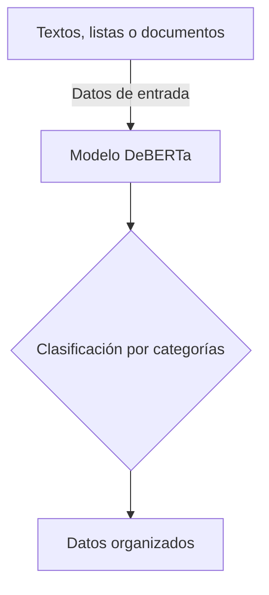

# Proyecto integrador segundo parcial

> IA organizadora de datos para estudiantes y trabajadores

**Proyecto integrador · Herramientas de IA**

**Grupo:** 1°B · **Equipo:** 67

## 2 👥 Integrantes

| Nombre completo | Rol en el proyecto|
|:---:|:-----:|
| Mariano Hernández Antuñano |Caso de uso, riesgos eticos, edicion del readme, estructurar el repositorio|
| Javier Emilio Aranda Espinoza |Investigacion y pulir el readme|  
| Alexa Gonzalez Del Castillo Torres | Investigación, organización y documentación del proyecto |  
| Paola Bocanegra Tellez |README, correcciones y organizacion|  

## 3 Problematica que resuelve 

## 4  Caso de uso

Una IA organizadora de datos ayuda a estudiantes o trabajadores a clasificar y ordenar grandes cantidades de información de forma rápida. El modelo analiza la información y la organiza por categorías, temas o prioridades.

- **Entrada:** El usuario proporciona datos desordenados, como textos, listas o documentos.
- **Salida:** El usuario recibe los datos estructurados y fáciles de consultar, ahorrando tiempo y esfuerzo.

## 5 Modelo abierto elegido

| Dato | Respuesta |
|:---:|:---|
| Identificador | [MoritzLaurer/deberta-v3-base-zeroshot-v2.0](https://huggingface.co/MoritzLaurer/deberta-v3-base-zeroshot-v2.0) |
| Tarea (pipeline tag) | `zero-shot-classification` |
| Número de parámetros | ~0.2 mil millones (200,000,000) |
| Licencia | El modelo base se publicó bajo la licencia MIT. |
| Limitación o sesgo declarado | El modelo solo puede realizar tareas de clasificación de texto. Los sesgos pueden provenir del modelo base subyacente, de los datos de entrenamiento NLI humanos y de los datos sintéticos generados por Mixtral. |

## 6 🔀 Cómo funciona

